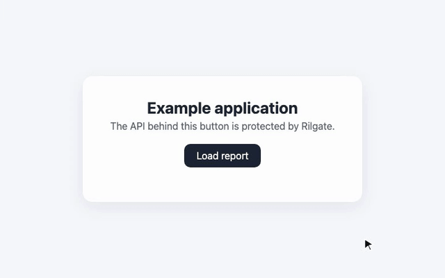

# Rilgate SDK

Client libraries for [Rilgate](https://github.com/ViGrise/rilgate), a reverse proxy gateway
that uses proof-of-work challenges.



## Packages

| Package | Language | Directory | Use |
| --- | --- | --- | --- |
| `@rilgate/browser` | TypeScript | [`packages/browser`](packages/browser) | Finds challenges on same-origin requests in a web page and its service worker. Solves each challenge once in a frame and retries the requests. |
| `rilgate-client` | Rust | [`crates/rilgate-client`](crates/rilgate-client) | Detects and solves fast and HashWX challenges with an application transport. |
| `rilgate-client-ffi` | Rust | [`crates/rilgate-client-ffi`](crates/rilgate-client-ffi) | Exposes the native client to Swift and Kotlin through UniFFI. |

Each package README gives its installation steps and API.

## Repository layout

```text
packages/<name>/
  src/          package source
  test/         tests, in the same folder structure as src/
  README.md     package documentation
crates/<name>/
  src/          Rust library and bindings source
  tests/        integration tests, where applicable
  README.md     crate documentation
```

In `packages/browser/src`, the `protocol/` and `core/` folders use no DOM API. The
`typecheck` script checks this with `tsconfig.dom-free.json`. A package for another
runtime can use these folders without a browser.

## Development

The repository has an npm workspace and a Cargo workspace. Node.js 24 or later
runs the TypeScript tests directly. The stable Rust toolchain builds the native
client and bindings.

1. Install the dependencies:

   ```sh
   npm install
   ```

2. Run the lint, type checks, tests and build of every package:

   ```sh
   npm run check
   ```

Run the Rust format check, lint, tests, and bindings generator:

```sh
cargo fmt --all -- --check
cargo clippy --workspace --all-targets -- -D warnings
cargo test --workspace
scripts/generate-bindings.sh
```

To add a package, create `packages/<name>` with its own `package.json` that has the
`build`, `typecheck` and `test` scripts. The root scripts run them in each package.

`docs/images/browser-sdk.gif` shows `@rilgate/browser` in an example application. The
recording script starts a Rilgate gateway that renders the real challenge page. The
browser solves no proof. The script plays the page states on a fixed timeline and
answers the retried API request. After a change to the SDK or to the challenge page,
record the GIF again:

```sh
npm run build
npx playwright install chromium
RILGATE_BINARY=<path to the rilgate binary> node scripts/record-browser-preview.mjs
```

The script needs `ffmpeg` and `ffprobe`.

## License

Apache-2.0. See [LICENSE](LICENSE).
